# HF channel simulator (`muf.sim`)

A channel simulator for HF sky-wave circuits whose parameters come from
chirp soundings. The idea is the dissertation's: a hybrid channel model --
modes after Watterson, Doppler, the dispersion within each mode, the
magneto-ionic split -- tuned by what the sounder measures. The
implementation is new; nothing is carried over from `gr-iono_ivanov`.

It lives in this package because everything it needs to be *tuned* is here
already: the readers for `.lfs`, chirpsounder2 and echo-window files, the
extractors, and `muf.trace`'s mode segmentation. A synthetic sounding is
also an `.lfs`, so muf processes it exactly as it processes a recording, and
the simulator can be checked by sounding its own output.


Stage 1 is the slow part, from the power ionogram: each mode's delay curve,
band and C/N0. Stage 2 is the fast part, from the dechirped record's phase:
the Doppler spread and its spectrum's shape, the Rice factor, the o/x split
(`muf sim fast`). What it does not do yet is listed at the end; how it
compares with the simulators before it, in [Related work](#related-work).
A Russian version of each figure sits beside it (`figures/*.ru.svg`,
drawn by `figures/build.py`).

## The state

A `ChannelState` describes one circuit at one moment as a list of modes.
Each mode is a set of curves over frequency, not a number:

| Field | Unit | Meaning |
|---|---|---|
| `freq_mhz` | MHz | knots, strictly ascending; the mode exists from the first to the last |
| `delay_us` | us | group delay at the knots -- the ionogram trace, scaled from range |
| `cn0_dbhz` | dB-Hz | carrier-to-noise density at the knots |
| `doppler_shift_hz` | Hz | frequency shift of the mode |
| `doppler_spread_hz` | Hz | ITU-R F.1487's *frequency spread*: 2 sigma of a Gaussian Doppler spectrum, or the full width at half power of a Lorentzian; 0 is a non-fading mode |
| `doppler_shape` | | `gaussian` (F.1487) or `lorentzian` (Vogler and Hoffmeyer's exponential autocorrelation) |
| `rician_k_db` | dB | a specular part this far above the scattered one; `null` is Rayleigh |
| `delay_spread_us` | us | RMS of a Gaussian power-delay profile about the curve, realised as paths a few us apart that fade independently (WSSUS, Vogler and Hoffmeyer's delay spread); 0 is one path, as in F.1487 |
| `ox_split_us`, `x_to_o_db`, `x_shift_hz` | us, dB, Hz | split into o and x waves: the x wave later, weaker or stronger, shifted more; `null` leaves the mode whole |

Between knots the delay is a monotone cubic (PCHIP), so GDD = d(tau)/df is
continuous and never overshoots the data. TOD = d2(tau)/df2 is the GDD's
difference across one knot spacing, which reads a quadratic curve to 0.03 %
where PCHIP's own second derivative is 5 % low. GDD is in us/MHz (1 us/MHz
= 1 ps/Hz), TOD in us/MHz^2.

Keeping the whole curve is the design decision everything else follows
from. A synthetic sounding samples it across the sweep. A signal at carrier
`fc` uses it around `fc`: in full, or truncated to its Taylor series --
delay, GDD, TOD -- which is the expansion of the dissertation's chapter 2.
Both describe the same channel, so each checks the other.

C/N0 rather than an ionogram dB value, because it means the same at any FFT
window and any signal bandwidth: a mode's SNR in a band B is C/N0 minus
10 log10(B).

### Provenance

Every mode field, and the state's circuit, epoch and sweep, carries a
provenance: an origin and a note.

| Origin | Meaning |
|---|---|
| `measured` | read off a sounding |
| `derived` | computed from measured values through a model |
| `prior` | a default from the literature or from other data |
| `model` | set by a scenario, with no data behind it |
| `forecast` | predicted for a later time: `muf sim forecast`'s persistence, the note saying what the value was before |

So a result can say which of its inputs were measured. `muf sim show STATE
--provenance` prints them.

### The file

A state is JSON (`"schema": "muf.sim.state"`, `"version": 1`) and is
written with full precision, so a state read back is the state written.

## Where a state comes from

### From a sounding: `muf sim state`

`muf.sim.observe` finds the trace the way `muf run` does -- an extractor
(`contour` by default), then `muf.trace`: points per contiguous run, tracks
followed across frequency, hop labels from the geometry, low and high rays
paired at the nose. Each track becomes one mode:

- **delay**: `muf.trace.reconstruct`'s smoothing spline on 0.1 MHz knots,
  converted from range with the format's own axis -- `.lfs` is calibrated
  with c = 3e5 km/s and divides by 2 for vertical sounding, v2 uses c exact
  and no divisor. Across a gap without points wider than 0.5 MHz the knots
  join the gap's edges in a straight line instead: the spline has no data
  there to hold it, and can swing thousands of km off the trace while still
  passing close to every point. A lone point beyond such a gap is taken as
  it is;
- **band**: the extent of the track;
- **C/N0**: the ionogram's power along the curve, summed over the five range
  bins around it (a Hann window spreads a tone over 1.5 bins, so the sum does
  not depend on where the echo falls between bins), less the noise those bins
  carry, averaged over +-0.2 MHz to average the fading.

The C/N0 conversion is exact for `.lfs`. muf divides each row by 4 ln 2
times its median, so a tone of carrier-to-noise density C/N0 peaks at
`C/N0 * T / (6 ln^2 2)` for a window of T seconds, and a noise bin averages
`1 / (4 ln^2 2)`. `tests/test_sim_sounding.py` checks the first constant
against `spectro`'s own normalisation. v2 puts its spectrogram on the same
scale only approximately, and the provenance says so.

An `.h5` product carrying an echo window cut from an `.lfs` (ionozond's
`echo_window` group, [echo-window.md](echo-window.md)) is read from the
window, through `echo_window.reprocess_window`: the capture's own rows and
full-band noise, so the scale and the C/N0 conversion are the `.lfs` ones,
over the window's range only. The product's power beside it is ionozond's,
formed at another row length with its own noise, and is not used. The loop
loads its synthetic `.lfs` at the window's range (`check.gate_of`), and the
next sounding at the same range, so all of them share the axis bin for bin;
for an `.lfs` that range is the default gate and nothing changes.

`figures/cn0.py SOUNDING.lfs [--mode 1F] [--at 24] [--lang ru]` draws what
this reads off any sounding: the trace and the five range bins summed around
it, one row across the trace with its noise taken off and scaled to 1 Hz,
and the mode's C/N0 along its band, row by row and as the state keeps it.
Neither the figure nor its sounding is in the repository.

What a power ionogram cannot measure -- Doppler shift and spread, the
fading law, the o/x split -- is filled from a prior and marked as one:
by default ITU-R F.1487's mid-latitude moderate spread, 0.5 Hz (`--doppler`
takes another condition or a value in Hz). `--fast` measures all of it but
the shift from the sounding's phase instead, as below.

### The delay spread: the trace's width

A mode with a delay spread arrives as many paths about its curve, each a
beat a little off the curve's, so its trace on the ionogram is wider than a
point echo's. `observe.cross_trace` reads that width. Row by row, over +-4
range bins on rows over 28 dB-Hz and clear of other modes, the power's
variance about its own centre less the variance the Hann window gives a
point echo there is the spread within the row; one row is one 0.2 s
snapshot of independently fading paths, narrower than their mean profile
and off its centre by chance, so the centres' scatter is added. Sounded
with a known spread and read back (states of 00:00, 12:00 and 18:00, four
seeds each), 10, 20, 40, 60 and 80 us read 7.7-11.5, 17.4-22.2, 37.4-42.1,
52.3-63.4 and 68.9-83.0 us, the means 2-7 % low; no spread reads 0-8 us,
the floor.

A real trace can be wider than a point echo without being scatter: a trace
that wanders about the smooth curve over several rows, or a beat that
jitters within a window, but coherent. Independent paths leave the trace's
centres independent from one row to the next (-0.4 to +0.3 on the synthetic
soundings); a coherent trace does not. So the width is kept with the state
(`metrics["cross_trace"]`) and becomes its delay spread only where the
centres are independent (`SCATTER_MAX_R1` = 0.4). The test needs no phase,
so it holds for power-only products too.

### The fast part from phase: `muf sim fast`

`muf.sim.fast` reads the fast part off the dechirped record -- an `.lfs`, a
chirpsounder2 product with `z`, or an echo window. After dechirping, a mode
is a tone that follows its delay curve along the sweep; a second dechirp
along the mode's own trace (as `lfs_tools/doppler_along_sweep.py` did in the
prototype) brings it to zero frequency, and a low-pass leaves its fading
gain times its slowly changing level. Then, mode by mode:

1. **Bands.** The mode is cut into 3 MHz bands, 30 s of sweep each, kept
   0.2 MHz from its low end and 0.5 MHz from its top.
2. **The trace re-centred.** The echo's offset from the tracker's trace is
   read off 2 s spectra and fitted with a quadratic in time.
3. **Second echoes.** A tracked mode within the filter's reach cuts a band
   only if the record confirms it: filtered to +-5 Hz along each trace in
   turn, both carry at least -13 dB of the mode's power. The tracker makes
   ghosts -- on a synthetic sounding of one path, a second and a third
   mode -- and those the record does not confirm. A confirmed one, the high
   ray near the MUF, cuts the band to its longest stretch clear of it.
4. **The pass band.** The widest of 40, 20 and 10 Hz that leaves no second
   echo inside and 10 dB of signal-to-noise; one for every band of a mode,
   so that they pool. The noise reference is the quietest of six offsets.
5. **The power, not the phase.** The trace is good to a few microseconds,
   and 10 us is 1 Hz of beat: the gain's phase carries the trace's error as
   a frequency modulation as wide as the spreads. Its power does not. For a
   Gaussian-scatter gain the power's autocovariance is |R(L)|^2; with a
   specular part, a quadratic in |R| that is solved for it.
6. **The first decorrelation.** A mode gives a minute or two of record, a
   few tens of fades, and the power's variance over so few is uncertain by
   +-40 %: fitting |R| down to 0.3 against that variance scatters as much.
   Instead the power's structure function D(L) = <(P(t+L) - P(t))^2>,
   pooled over the bands, is divided by the power's second moment -- both
   are made by the same strong fades, and their ratio is good to 5-15 % --
   and |R| is fitted only down to 1/sqrt(2). A slow change of level scales
   both alike and drops out. Gaussian and Lorentzian fits are compared and
   the better kept; the Lorentzian's model includes what the low-pass does
   to its tails, so even a 10 Hz pass reads a 4 Hz Lorentzian unbiased.
7. **Rice K** by moments (Greenstein), the noise reference's power taken
   off, kept only where the scattered part's normalised variance is 2
   standard errors below Rayleigh's 1. With fewer than about 20 fades in the
   record, a K under 6 dB cannot be told from Rayleigh; the estimate then
   also says what the spread would be if the moments' K were real.
8. **Two waves.** o and x waves -- or two rays -- a few tens of microseconds
   apart fade independently and beat along the sweep at rate times split:
   30 us is 3 Hz at 100 kHz/s. Read as one wave the beat passes for a spread
   several times the true one. Where |R|^2 climbs back after its first fall
   and two beating waves fit at least twice as well as one, the pair is
   kept: its beat gives `ox_split_us`, its depth `x_to_o_db`. No power
   ionogram resolves that split.
9. **Level swings.** Where the power varies more than any fading can
   (gamma significantly above 1), the bands are divided by their running
   mean over ten coherence times and fitted again.
10. **Scatter.** A jackknife over the bands gives the spread's band-to-band
    scatter.

What one up-sweep cannot give: the **Doppler shift** -- it moves the beat
exactly as a delay change of shift / rate would, and the power holds no
frequency at all -- nor which of two waves is x, nor a differential shift
between them. The shift stays a prior; the weaker wave is taken as x.
A channel that has not decorrelated to 1/sqrt(2) within 10 s gives an upper
bound on the spread, below about 0.03 Hz.

`muf sim fast --calibrate` sounds known fast parts through the `law`
preset and reads them back -- the closed loop, with the tracker's traces --
and the results are under [Checks](#checks).

### From a scenario: `muf sim preset`

- **ITU-R F.1487 test channels.** Two independently fading paths of equal
  mean power, no shift, no magneto-ionic split, as Annex 3 prescribes, with
  its differential delays and frequency spreads:

  | Condition | Delay, ms | Spread, Hz |
  |---|---|---|
  | low-quiet / moderate / disturbed | 0.5 / 2 / 6 | 0.5 / 1.5 / 10 |
  | mid-quiet / moderate / disturbed | 0.5 / 1 / 2 | 0.1 / 0.5 / 1 |
  | mid-disturbed-nvis | 7 | 1 |
  | high-quiet / moderate / disturbed | 1 / 3 / 7 | 0.5 / 10 / 30 |

  (Rec. ITU-R F.1487 (05/2000), Annex 3 sections 2-4.)

- **`law`**: one dispersive 1F mode on cyprus1's circuit and sweep, its
  delay the integral of the dispersion law GDD(f) = b (1/sqrt(1 - f/MUF) - 1):

      tau(f) = tau0 + b MUF (2 (1 - sqrt(1 - x)) - x),   x = f/MUF

  b = 7.52 us/MHz by default, fitted to the 1F low ray over 583 sweeps of
  cyprus1 -> Yoshkar-Ola, 4-9 February 2026. The law's GDD diverges at the
  MUF itself, so the knots stop at 0.995 MUF, where it is 99 us/MHz.

## Two ways to realise a state

### A sounding: `muf sim sounding`

A chirp sounder dechirps the received sweep against its own, so an echo of
group delay tau arrives as a tone at beat frequency `-rate * tau`. As the
sweep climbs, the beat follows each mode's delay curve:

    x(t) = sum_m a_m(f(t)) g_m(t) exp(j 2 pi integral(-rate tau_m(f(t)) dt)) + noise

with `|a_m|^2 = (C/N0)_m / fs` against unit-variance noise, and `g_m` the
mode's Watterson fading -- which along a sweep is also fading across
frequency. A mode rolls on and off over 0.05 MHz centred on its band's
edges, so it is at full level wherever it was measured. The result is
written as an `.lfs` with a full header and goes through muf like any
recording.

The phase is the beat integrated in time, the first-order (stationary
phase) form of a dechirped echo. The dispersion *within* one FFT window is
about GDD (rate T)^2, 0.3 us for 30 us/MHz over a 20 kHz window -- under a
hundredth of a range bin.

### A signal: `muf sim channel`

A complex baseband signal at `fs`, centred on `fc`, goes through every mode
present at `fc`, each a dispersive filter followed by a fading gain:

    y(t) = sum_m g_m(t) (h_m conv x)(t)

The filter's phase is minus 2 pi times the integral of the delay from `fc`,
so its group delay is exactly the curve. How much of the curve it uses is
`--dispersion`:

| Value | Delay used |
|---|---|
| `none` | tau(fc) only |
| `gdd` | tau0 + GDD df |
| `gdd+tod` | tau0 + GDD df + TOD df^2 / 2 |
| `full` (default) | the curve itself, and the mode's level across the band: above its MUF the mode is not there |

Filtering first and fading second is exact when the fading is slow against
the filter's length, here a channel that decorrelates in a second against
a few hundred microseconds of dispersion.

Levels: by default the output is normalised so the modes' mean powers add up
to the input's, and `--snr-db` sets the noise in the simulated band (or in
`--snr-bandwidth`). `--absolute` keeps the state's C/N0 with unit noise
density instead. The output is longer than the input by the channel's
spread; the `.json` beside it says where input sample 0 at the earliest
path's delay landed (`lead_samples`), and lists every path.

`muf.sim.channel.Realisation` gives the same draw as a signal (`apply`)
and as a transfer function H(t, f) (`transfer`), so an equaliser's view of
the channel and the signal it equalises agree.

The fading gains (`muf.sim.fading`) are complex Gaussian processes with a
Gaussian Doppler spectrum, or a Lorentzian one, drawn once on a grid 32
sigma fast (320 half widths for the Lorentzian, whose autocorrelation has a
cusp at zero lag that a coarser grid rounds off) and read at any time, so a
10 M-sample sounding and the transfer function of the same realisation
agree, and the cost does not depend on `fs`.

## Commands

```bash
# a sounding's channel, as a state; print it expanded at 25 MHz
muf sim state /data/2026.02.04/cyprus1_20260204_120010.lfs --out s1200.json --fc 25

# a test channel, and the dispersion-law scenario
muf sim preset --list
muf sim preset mid-moderate --out mid.json
muf sim preset law --muf 25 --out law.json

# what a state holds, and where each value came from
muf sim show s1200.json --fc 25 --provenance

# a synthetic .lfs of it -- 80 MB, as a recording
muf sim sounding s1200.json --out /tmp/sim --seed 1

# a signal through it: a test chirp across 80 % of 48 kHz, 20 dB SNR in 3 kHz
muf sim channel s1200.json --fc 25 --fs 48000 --test chirp --duration 2 \
    --snr-db 20 --snr-bandwidth 3000 --out y.npy

# the fast part from the sounding's phase: spread and shape, Rice K, o/x split
muf sim fast /data/2026.02.04/cyprus1_20260204_180010.lfs --out s1800.json
muf sim state /data/2026.02.04/cyprus1_20260204_180010.lfs --fast

# the estimator calibrated: known spreads, and an o/x split, sounded and read back
muf sim fast --calibrate --realisations 2
muf sim fast --calibrate --spreads 0.2,0.5,1 --shapes gaussian --split 30 --x-to-o -3

# the closed loop on a real sounding (below): recovery, realism and the
# ionogram correlation, with the natural change over one repetition and the
# fast part in the loop
muf sim check /data/2026.02.04/cyprus1_20260204_180010.lfs \
    --next /data/2026.02.04/cyprus1_20260204_180510.lfs --fast

# persistence: the 12:00 state issued as the forecast for 12:05, and scored
# against the 12:05 sounding -- MUF and LOF, censored at the band's edges,
# and a MUF anywhere in a recording cut short of its sweep, as the SAO export
# has it; every mode paired by delay in both directions; and the link a modem
# would see at each working frequency inside both recorded bands, with its
# events: a mode seen, and the SNR in the modem's band over its floor
# (muf/sim/forecast.py, muf/sim/link.py); with --copies, the ionograms too,
# on the range and band both hold: 12:00's against 12:05's, and synthetic
# soundings of the forecast against 12:05's, around both states' traces
muf sim forecast /data/2026.02.04/cyprus1_20260204_120010.lfs --out f1205.json
muf sim forecast /data/2026.02.04/cyprus1_20260204_120010.lfs \
    --next /data/2026.02.04/cyprus1_20260204_120510.lfs \
    --carriers 7.5:32.5:0.25 --bandwidth 3000 --snr-min 10 --copies 12 \
    --json pair.json

# the same over every pair of soundings 300 +- 30 s apart: rows written one
# pair at a time to out/forecast/feb (pairs, modes, carriers, ionogram,
# recovery and skipped .jsonl, run.json); states cached by file and
# parameters; four copies of each forecast shared between the ionograms and,
# on every 12th sounding, the closed loop; --resume carries an interrupted run
# on (muf/sim/series.py). Six days of five-minute soundings take 91 minutes
# at --jobs 4 on a 32-thread Windows PC; a resume over a finished run, 18 s
muf sim series /data/2026.02.0[4-9] --circuit cyprus1:yoshkar-ola \
    --lead 300 --tolerance 30 --copies 4 --recovery-every 12 \
    --carriers 7.5:32.5:0.25 --jobs 4 --resume --out out/forecast/feb

# the run summed up from its rows into summary.json: every figure with a 95 %
# interval from a moving block bootstrap (blocks of 12 pairs within unbroken
# stretches, 4000 resamples, rng 0), cut by hour, day, sun and lead, the
# carriers by f over the truth's MUF (muf/sim/summary.py); under a minute for
# six days. At a correlation of about 0.3 from one pair to the next, the
# intervals cover the mean 94 % of the time; on a series as tied as AR(1)
# with rho 0.9 they would cover only about 85 %
muf sim summary out/forecast/feb --by hour,day,sun,lead,fmuf

# as it would run live: the soundings in time order; on each, the forecasts
# issued for its time scored, then new ones issued from it for the circuit's
# next two soundings -- 5 and 10 min ahead on cyprus1, 10 and 20 on NIC2, the
# interval the median of the last six gaps; --lead S,S chooses others. A
# forecast with no sounding within 30 s of its time lapses, and so does one
# whose sounding has no trace. A forecast is the channel simulator's: the
# persisted state is synthesised as a sounding at the forecast's time (seed
# 0), its echo window kept as <source>.<lead>s.sim.echo.h5 beside the states,
# and that product observed as a real one is; one the simulator cannot make
# is an "unsimulated" event and is not issued. Only the modes are scored
# (MUF, LOF, each mode's delay, C/N0 and top), the state observed from the
# synthetic sounding against the truth's, and after each score the last
# hour's figures are printed by lead, weighed as muf sim summary weighs them
# (muf/sim/live.py, muf/sim/series.py simulation). --pace 60 plays an hour a
# minute, 1 in real time; --out keeps every event as JSON Lines. The
# simulator adds a few seconds a forecast, and its figures are not the
# series': muf sim series scores the persisted state itself
muf sim live /data/ionozond/2026.10.24/lfm_ionogram-NIC2-*.h5 \
    --circuit NIC2:yoshkar-ola --out out/forecast/live.jsonl

# level 0: the generator against closed-form theory
muf sim verify
```

## Checks

Three levels, as in the prototype this grew out of
(`sw_channel_modeling/lfs_tools/sim_proto.py`), each against a stated
reference rather than against itself.

What the checks find on real soundings is not in this repository: it is
part of a dissertation in progress and is published there first. What
follows is how each check works, and what it finds where the answer is
known.

### Level 0: the generator against theory -- `muf sim verify`

The unit tests, `tests/test_sim_*.py` (252, about three minutes),
hold each part to what it is told: a path delayed 1 ms arrives 48 samples
late at 48 kHz; the filter's group delay equals the curve to 0.01 us; an
echo in a synthetic `.lfs` lands within half a range bin of its delay and
reads its C/N0 to 0.2 dB; the extractors find the state's MUF to 0.05 MHz.

`muf sim verify` holds the generator to closed-form theory, 77 checks, each
with its basis and a tolerance from its own statistics (a test of N
independent samples gets a tolerance in 1/sqrt(N), not a round number):

| Group | Checked against |
|---|---|
| Fading: 0.5 and 1 Hz Gaussian, 1 Hz Lorentzian, 1 Hz Gaussian with K 6 dB | mean power; envelope CDF, Rayleigh or Rice, by KS distance; \|R\| at 0.8, 0.5, 0.2 against the Fourier transform of the spectrum; RMS width, F.1487's spread = 2 sigma; half-power width, ITS 98-348's -3 dB reading; level-crossing rate and fade duration at 0 and -10 dB, Rice's formulas; K by moments (Greenstein et al. 1999) |
| S(tau, nu) of F.1487 mid-moderate and mid-disturbed, Gaussian and Lorentzian, at 10 MHz | each path's delay, power share, shift and spread read off the scattering function the way ITS 98-348 reads its measured ones |
| Dispersion of the `law` mode at 21, 23 and 24 MHz over 1 MHz | the delay extent of the band, \|GDD\| B |
| DBPSK at 2400 bit/s through 1 Hz of flat Rayleigh fading | BER (1 + g(1 - rho)) / (2(1 + g)) at Eb/N0 0, 10, 20 dB |
| Delay spread 20 and 50 us, Gaussian | the paths' RMS; \|R(df)\| = exp(-2 pi^2 sigma^2 df^2) at 0.8, 0.5, 0.2, the frequency correlation of uncorrelated scattering (Bello 1963) |

How long each runs follows F.1487 Annex 3 sec. 6: max(3000 / spread,
100 / (BER rate)) seconds, so a test sees enough fades and errors to mean
something (`--quick` runs a tenth, with looser tolerances).

### Level 1: recovery

A state, sounded and read back through the same processing, gives the
state again. For the slow part `muf sim check` runs it on a real sounding's
state, twelve synthetic soundings by default (seeds 0-11), and reports for
each mode the delay bias and RMS, the C/N0 bias, and the synthetic MUFs
against the real one. A range bin is 14.65 km, 49 us; the report also gives
the RMS as group path, c times the delay, the unit Lv et al. (2022)
validate their model in. Near the nose `muf.trace` can hand parts of one
branch to the other, on synthetic soundings as on real ones, so the high
rays' errors there measure the tracker as much as the synthesis -- a
measurement only a sounding with a known answer can make.

For the fast part, `muf sim fast --calibrate` sounds the `law` mode with
known spreads and reads them back, two seeds each; and the estimator's
statistics over many realisations are measured on drawn gains, filtered as
a band's record is (`tests/test_sim_fast.py`):

Sounded and read back, `law` mode at 45 dB-Hz, three 3 MHz bands (about
85 s of record), two seeds each:

| Spread | Gaussian, read | Lorentzian, read |
|---|---|---|
| 0.1 Hz | 0.078, 0.105 | 0.102, 0.107 |
| 0.25 Hz | 0.228, 0.263 | 0.218, 0.183 |
| 0.5 Hz | 0.456, 0.520 | 0.411, 0.514 |
| 1 Hz | 0.950, 0.988 | 0.955, 1.067 |
| 2 Hz | 1.989, 1.897 | 1.724, 2.014 |

The shape was read right in all twenty. On drawn gains, 24 realisations
each, the median reads 0.96-1.02 of the truth from 0.25 to 4 Hz, either
shape, through a 40 or a 10 Hz pass, at 30 dB SNR, and within 6 % at
10 dB; the 68 % interval is +-8 % at 0.5 Hz (some 45 fades) and +-5 % at
2 Hz. At 0.1 Hz, nine fades, the median reads 8-11 % high within +-20 %:
the scatter of the record, which no estimator escapes. A Rice factor of
6 dB or more is found in every realisation at 0.5 Hz and up, its median
within 0.2 dB, the spread unbiased; 3 dB is found in 29 %, 0 dB not at all -- and an
undetected specular part makes the spread read low, 0.72 of the truth at
0 dB, which is why the estimate then also gives the spread the moments' K
would imply.

An o/x split is recovered from one sweep's power. 30 us at -3 dB reads
29.9-31.2 us at 0.2, 0.5 and 1 Hz of spread, the weaker wave -2.5 to
-4.9 dB, the spread 0.17-0.20, 0.42-0.58 and 0.96 Hz -- where one wave
would have read 2.1-3.0 Hz at 0.5 Hz; 50 us at 1 Hz reads 50.2-51.3 us.
Once in six the 1 Hz pair is taken for Lorentzian and its spread read as
half-power width, 0.47 Hz. A beat is only told from fading when one wave
is still correlated a beat period on (`PAIR_ENVELOPE`): a split whose beat
is not well clear of the spread -- 10 us, 1 Hz of beat, on 0.5 Hz -- is
not resolved, and its spread reads twice too high. Without that rule, a few
fades' worth of noise in a slow record passed for a pair twice in twenty
single-wave soundings; with it, none.

`muf sim check --fast` puts the fast part in the loop: measured on the real
sounding, sounded into every synthetic one, read back from each.

### Level 2: realism

The real sounding a state was made from should be one more of its
synthetic soundings: its MUF among theirs, and how its level scatters
along each mode's trace, which the fast part sets and the slow curves do
not. The level scatter also catches a trace the state describes badly: a
real trace broken into patches at several ranges, where the smooth curve
the state keeps runs between them and the five summed bins catch the echo
in some rows and miss it in others, scatters far more than synthetic
soundings that follow the curve and scatter by the fading alone.

**How a verdict is drawn.** Every level-2 verdict is drawn one way. The
real value's distance from the synthetic soundings' mean is measured in the
standard deviation one more synthetic sounding would have -- theirs, times
sqrt(1 + 1/n) for the error of their mean -- and within 3 sd the real
sounding is taken for one more of them. The MUF, read on the ionogram's
rows, adds the rows' rounding, step^2/12 of variance: when all twelve
synthetic MUFs fall on one row, without it any other row would be
infinitely far. A verdict needs twelve synthetic soundings, the default
(0.65 s each; the fast part, 13 s each, is read back from the first three);
with fewer the numbers are given and no verdict. The rule this replaced --
inside the synthetic [min, max] -- called a true copy OUTSIDE 2/(n + 1) of
the time under exchangeability, half the time at its default of three
soundings, and could not tell 0.01 MHz from 1 MHz outside the range.
Calibrated on true copies -- a state sounded once more and read as if it
were the real sounding, 25 times for each of three states -- it calls
OUTSIDE the MUF 0 times in 75; the ionogram correlation
1 in 75 row by row and 0 in 75 smoothed, per mode 2 and 3 in 200; the level
scatter 5 in 128. The level scatter's tail is the tracker's: in four of the
five the copy's own weak trace was followed 87-172 us RMS off its curve,
once into another mode, and its level scattered 10-27 dB against 3-6 dB --
a failure the synthetic soundings show too, once or twice in twelve. An
OUTSIDE level scatter on a weak mode says the mode is not followed as one
smooth trace; whether the tracker or the ionosphere breaks it, the trace
drawn tells.

`--next SOUNDING` adds the **natural change**: the circuit's following
sounding matched against this one as a recovery would be, so the numbers
read on the same scale. A recovery error well inside the natural change is
a simulator that resolves more than the channel holds still for.

The first version of the synthesis rolled each mode off *inside* its band,
which ate the top rows of the trace and put every synthetic MUF 0.03 MHz
low -- the real MUF fell outside the spread. Level 2 found it.

**The ionograms themselves.** A synthetic sounding is processed as the real
one is -- the same sweep, window and carrier suppression -- so the two
ionograms share one grid, cell for cell, and can be compared as images.
`check` correlates their dB maps (Pearson's r) over the cells within +-5
range bins of the state's traces across their bands: the five bins C/N0 is
summed over and three more either side, so that a trace in the wrong place
or of the wrong width counts, not only its level. Two maps: every row as
read, fading and all, and each range bin averaged over +-0.2 MHz, the
resolution the state keeps C/N0 at. Cells the carrier suppression flattened
in any of them are left out of all. The same is done for each mode alone.

The scale is the synthetic soundings among themselves. Two soundings of one
state differ only by fading and noise, so their correlation is as far as a
state can reproduce a sounding; a real sounding the state described
completely would correlate with them as they do with each other. The
verdict is the one above, leave-one-out and in Fisher's z = atanh r, where
r near 1 is squeezed against its bound: each synthetic sounding's mean z
with the others is what one more realisation gets, and the real one's mean
z with all of them is set against their spread. It is one-sided -- a real
sounding more like the copies than they are like each other is no defect.
A trace moved three range bins reads r = -0.27 against 0.86 for the
copies, OUTSIDE every time. With `--next`, the correlation between the real
sounding and the next is the natural reference.

The level-2 check also reads each trace's width off every synthetic
sounding and sets the real one against them.

### Seeing it: the console

`python docs/ui/console.py SOUNDING ...` runs the same check for each
sounding (`.lfs`, or `.h5` with an echo window), with the next one of the
circuit as the reference. It writes one self-contained page,
`docs/ui/console.html`, built from `services/api/sim_console.html`, which
stays out of the repository because it embeds the soundings it was built
from;
`--json FILE` writes the data alone as well, for a page that loads it. What
the page draws is gathered by `muf.sim.console.build`. The page shows:

- the real ionogram beside three of the copies, the next sounding, or the
  difference, with the state's curves and the correlation's cells drawn on
  top;
- a row cut across the traces;
- the mean profile across a trace, beside the copy's;
- C/N0 along a mode;
- every level-2 verdict as z on one axis;
- the correlations against their ceiling and the next sounding;
- the state with its provenance;
- |H(f, t)| and the paths at one carrier.

It computes nothing the check does not. `--reuse PAGE` puts the data of a
page built before into a changed template without running the loop again.

The hub serves the same page at `/ui/sim`: pick a sounding and press *Run
the simulator* (the archive capability, as a rescan needs). The build is
queued, runs one at a time in a process of its own, stops after 15 minutes,
and is kept in `SIM_CACHE` (default `sim/` beside the database) under the
image's build stamp, so a new image builds a console again rather than show
an old simulator's. On the work PC, in Docker, a 2026-02-04 `.lfs` took
about 15 s. While it runs, the page shows how far it has got: the sounding
observed, each synthetic sounding read back, and the page drawn.

The hub also runs `muf sim live`'s loop on the soundings its scans store,
and shows it at `/ui/sim/live` (`services/api/sim_live.py`): each circuit's
forecasts waiting, the last forecast of each lead against its truth with
both ionograms, the figures of the last hour and day, and the latest
events. The forecast's ionogram is the simulator's synthetic sounding,
drawn by `/sim/live/simulated/{name}.png` with the same renderer and colour
scale as the truth's `/ionogram/{id}.png`; `?like={id}` draws it on the
range and at the range step of that truth's picture, so the two read alike.
It is kept beside the loop's states (`LIVE_CACHE`) and forgotten with them
after six hours, about 2 MB a forecast. Events from before the simulator scored the forecasts
(version 1) scored the persisted state itself, and show no forecast image. It runs only on the circuits an operator follows, with the page's
Follow and Stop buttons (the archive capability, as a rescan needs); the
others cost nothing. A thread looks every `LIVE_INTERVAL_S` (60 s; 0 turns
it off) for a followed circuit's soundings newer than the last it took and
runs each turn in a process of its own. A circuit followed begins at its
newest sounding, so the archive's past is not replayed, and a sounding
stored after a later one was taken is passed over. Events are kept for
good; `LIVE_KEEP_DAYS` above 0 forgets the older ones. A scored event keeps
the pair's working frequencies too, each frequency's two events and its
SNR, and the sun's zenith angle at the control point. The loop is only as
live as the scans: at the
default scan of every 15 minutes a five-minute circuit is forecast and
scored three soundings at a time, so a hub that shows it sets
`ARCHIVE_SCAN_INTERVAL_S` to 60-120. When the NAS itself is slow, use
[direct station delivery](direct-station-ingest.md): the laptop pushes completed
HDF5 products to local hub storage and a separate worker ingests them without
waiting for archive discovery. Set `DIRECT_INGEST=1` and run the station
uploader; the simulator's polling and follow controls stay the same.

At the top of `/ui/sim/live`, **Forecast and reception now** pairs a synthetic
ionogram on the left with the receiving sweep on the right. Select the agent
station if its receiver alias is not uniquely mapped. The right pane uses
the same SSE column stream as `/ui/live`, reconnects from a snapshot, and
leaves missing columns blank. Both panes show the sweep's frequency and
group-delay extent with the Live view's colour scale. The receiving timestamp
and count of received columns remain visible, including between sweeps.

The left pane shows an already issued persistence forecast for that sweep,
the one issued within 30 seconds of the sweep's start with the shortest lead.
It draws the synthetic sounding the live loop kept when it issued that
forecast. This is the same product the forecast's panels below draw and its
scores were read from; it is not synthesised again when the page asks.

The product is read back with the FFT window the sweep is received with
(16384 samples on the station's live feed), so its range bins are the
received ones. It is folded into the page's raster by the maximum, exactly
as `sim-reception.js` folds the received sweep, rather than interpolated.
Fed identical samples, the station's capture and this pane give the same
value in every cell. The echo-window product of those samples comes within
one quarter-dB step of them.

Received powers never enter the product; they supply only the display axes.
A single background worker bounds the cache/queue to eight forecasts and each
build to 120 seconds. The page says so while a forecast is building, when
none matches, and when its product is no longer kept: products are pruned
with the loop's states after six hours. Fields the observed state cannot
measure, such as its fading prior, remain model assumptions in the synthetic
image.

Scores and historical pairs below still update every 30 seconds, without
reloading the page or interrupting the receiving stream. This feature needs
only an updated API image; the existing station live agent is unchanged.

`GET /sim/live/{tx}/{rx}/events?after=ID` reads a circuit's events out as
JSON Lines, oldest first, each as `muf sim live --out` writes it -- a score
with its forecast and truth side by side -- with the hub's id added.
`tools/pull_live_events.py --hub URL --out DIR TX:RX ...` appends each
circuit's new events to `DIR/TX__RX.jsonl`, carrying on after the last id the
file holds, so a copy kept elsewhere never repeats a line.

The live loop scores only what comes after a circuit is followed.
`/ui/sim/periods` (`services/api/sim_period.py`) scores the past instead:
choose a circuit, a first and last day (UTC) and a lead, by default the
soundings' interval, and press *Score* (the archive capability). The hub
runs `muf sim series` on the circuit's soundings of those days with
`--copies 0 --recovery-every 0`, then `muf sim summary`, one run at a time in
a process of its own, and the page follows it with a progress bar: each
sounding observed, each pair scored, then the summary. A finished run shows
its summary -- pairs and those set apart for the clock, the MUF's, LOF's and
modes' errors with their intervals, mode counts, carriers, and the MUF by
hour and by the sun -- and offers `summary.json`, `run.json` and the rows to
download. Runs are kept in `SIM_CACHE/periods/`, without their states. A run
covers at most 7 days and 2000 soundings; one the hub restarted during reads
as failed. On the work PC, in Docker, a day of 129 `.h5` soundings took
about 5.5 minutes. A figure needs 30 pairs. A day of a ten-minute circuit
makes at most 143, fewer once the pairs with no trace or a broken clock drop
out, so it gives the whole day's figures at best and none by the hour; the
hours need five days or more.

The same page sums up the live loop's own forecasts: choose *Live forecasts*
as the source, a circuit the loop scored, its days and one of the leads it
forecast. Nothing is scored again. The scored and lapsed events of those days
are written out as a series' rows (`muf.sim.live.as_run`), a lapsed forecast
as a pair not scored, and summed up as a period of the archive is, in
seconds. Its `carriers.jsonl` holds each frequency's two events and SNR
only, as the loop keeps them, and its `run.json` says `"source": "live"`.
The 7-day limit holds; the soundings one does not, as none is read. Under a
finished run the page says what each file offered for download holds.

A receiver whose GPSDO has lost lock free-runs, and its echoes jump with its
clock from one sounding to the next. A forecast scored across such a jump
measures the clock, so each pair is checked (`muf/sim/clock.py`): every
sounding records where its echo begins against the ground line, the reading
the station's `epoch_offset_s` takes, and a pair is **clock-suspect** when
that moved more than 250 us between its two soundings, or when either
echo begins outside the station's window (0.5 ms before the ground line to
two hops at 450 km). A suspect pair is still scored, with the verdict
beside its values (`clock` in a live event and in a series' `pairs.jsonl`),
and set apart: the live figures, the page and `muf sim summary` leave it
out and count it. The jump is not taken out of the truth, since it also
holds the ionosphere's own change. A run observed before the check carries
no verdict, so nothing in it is set apart until it is run again.

## Related work



Searched in October 2026; the closest are these.

- **Watterson; ITU-R F.1487.** Two independently fading taps, Gaussian
  Doppler, no dispersion, parameters from a table of path conditions; the
  recommendation calls bandwidths beyond about 12 kHz problematic. The
  `preset` command builds its test channels, and level 0 measures against
  its definitions and test lengths.
- **Vogler and Hoffmeyer; Mastrangelo et al.; Sutherland (ITS, 1988-1998).**
  The wideband model: up to three modes, a sech^2 layer for the
  deterministic dispersion, a Doppler "slant" across each mode's delay
  spread, a Lorentzian (exponential) Doppler spectrum, 1 MHz of bandwidth;
  parameters from NRL sounder measurements and ionograms, a hardware
  simulator, and validation by comparing scattering functions. The
  Lorentzian shape here and the reading of spreads off S(tau, nu) at
  -3 dB follow it.
- **Physical models: Gherm, Zernov and Strangeways; HiCIRF (Nickisch et
  al. 2012); Lv et al. 2022; ISTP (Ponomarchuk, Kurkin).** Rays through a
  model medium -- IRI and its fluctuations -- with the complex phase
  method, o and x modes, realisations of E(t) and S(tau, nu), compared
  with sounding. Gherm et al. criticise the empirical models for setting
  each mode's Doppler independently and assuming independent taps; the
  first is a fair point against this simulator too (below).
- **DAMSON (Angling), Warrington.** Spreads in delay and Doppler measured
  over 3-12 kHz, simulated as Watterson with a Lorentzian, and judged by
  modem performance and availability.
- **Volgatech school (Ivanov, Ryabova).** The closest in spirit: chirp
  sounding of dispersion, its trend and noise, a channel impulse response
  for a chirp, the losses wideband dispersion causes and their correction.

None takes the state directly from routine chirp-sounding traces and
checks itself by sounding its own output through the same processing; and
none measures the o/x split from the beat of the two waves along one sweep.
Those two are what this simulator adds -- the second still to be checked
against an independent measurement of the split.

Sources:
[NTIA TR-88-240](https://its.ntia.gov/publications/download/TR-88-240.pdf),
[NTIA 90-255](https://its.ntia.gov/publications/download/90-255_ocr.pdf),
[NTIA TR-92-284](https://www.its.ntia.gov/publications/download/92-284.pdf),
[Vogler and Hoffmeyer, Radio Science 1993](https://www.semanticscholar.org/paper/A-model-for-wideband-HF-propagation-channels-Vogler-Hoffmeyer/1789ba40bb41243b9a713e5fadff26303f3c81df),
[Sutherland, NTIA 98-348](https://its.ntia.gov/publications/download/98-348_ocr.pdf),
[ITU-R F.1487](https://www.itu.int/dms_pubrec/itu-r/rec/f/R-REC-F.1487-0-200005-I!!PDF-E.pdf),
[Gherm et al., URSI 2005](https://www.ursi.org/files/CommissionWebsites/commg_ursi2005/oral/g02a_0893.pdf),
[Gherm et al., Radio Science 2005](https://www.researchgate.net/publication/260854987_HF_propagation_in_a_wideband_ionospheric_fluctuating_reflection_channel_Physically_based_software_simulator_of_the_channel),
[HiCIRF](https://agupubs.onlinelibrary.wiley.com/doi/10.1029/2011RS004928),
[Lv et al., Remote Sensing 14, 4133 (2022)](https://doi.org/10.3390/rs14174133),
[Ponomarchuk et al., Solar-Terrestrial Physics 2024](https://naukaru.ru/en/storage/download/159440),
[Ryabova et al., Vestnik Volgatech 2025](https://journals.rcsi.science/2306-2819/article/view/400153),
[Ivanov et al., Radiotekhnika 2024](http://radiotec.ru/ru/journal/Radioengineering/number/2024-8/article/24435),
[Ivanov et al., ITM Web Conf. 2019](https://www.itm-conferences.org/articles/itmconf/pdf/2019/07/itmconf_crimico2019_15021.pdf),
[Angling, thesis (DAMSON)](https://figshare.le.ac.uk/articles/thesis/Measured_and_simulated_scattering_functions_and_their_impact_on_high_frequency_HF_systems/10162685/1),
[Warrington et al. 2006](https://figshare.le.ac.uk/articles/journal_contribution/Measurement_and_modelling_of_HF_channel_directional_spread_characteristics_for_northerly_paths/10079777/1).

## What is not here yet

- **The Doppler shift.** One up-sweep cannot tell a shift from a delay
  change; the shift stays a prior. The slow drift of delay between
  soundings, or an up and a down sweep, could give it.
- **Doppler across modes and along a trace.** Each mode's spread is
  measured on its own, and is one number across its band. Gherm et al.'s
  point stands: the modes' Doppler is not independent, and a law tying
  them (2F about twice 1F for a layer moving as one) is not imposed.
  Vogler and Hoffmeyer's slant, Doppler across the delay spread, is not
  modelled either.
- **A channel richer than one or two waves.** On real soundings the bands
  of one mode can disagree, quasi-specular components beat at fractions of
  a hertz under the fading, and a pair seen where the mode is strong is
  lost where it is weak: along 3 MHz of sweep the channel is not
  stationary. The estimator reports these as scatter, notes and warnings
  rather than fitting them.
- **h5-only states.** Products without `z` -- all of August and September
  2026 -- keep the prior; the level scatter along the trace (level 2) is
  the power-only handle on the fast part, still to be calibrated against
  the February `.lfs` the phase is measured on.
- **Coherent trace structure.** Real traces can be wider than a point
  echo with their centres correlated from row to row: a trace that
  wanders about the smooth curve, or a beat that jitters inside a window,
  not scatter (the delay spread, above). Neither is modelled; a delay ripple
  along frequency, of an RMS and a correlation scale read off the centres,
  would be the first, and the phase of the second dechirp would tell the
  two apart.
- **Noise is white.** Broadcast carriers and impulsive interference are not
  synthesised; muf's carrier suppression runs on real soundings only.
- **v2 output.** Synthetic soundings are `.lfs` only; a chirpsounder2
  product with `z` is not written. C/N0 from v2 products is approximate.
- **Time.** A state is one moment. Series of states and the forecast of the
  next one -- persistence, climatology, the Ornstein-Uhlenbeck anomaly about
  the daily course, the Kalman filter across circuits, `services/prediction`
  -- come next.
